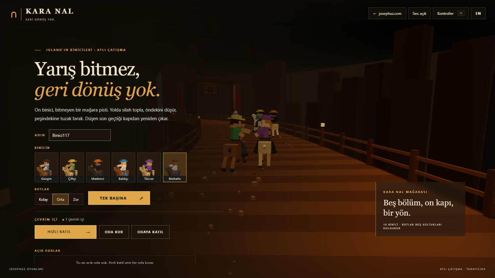
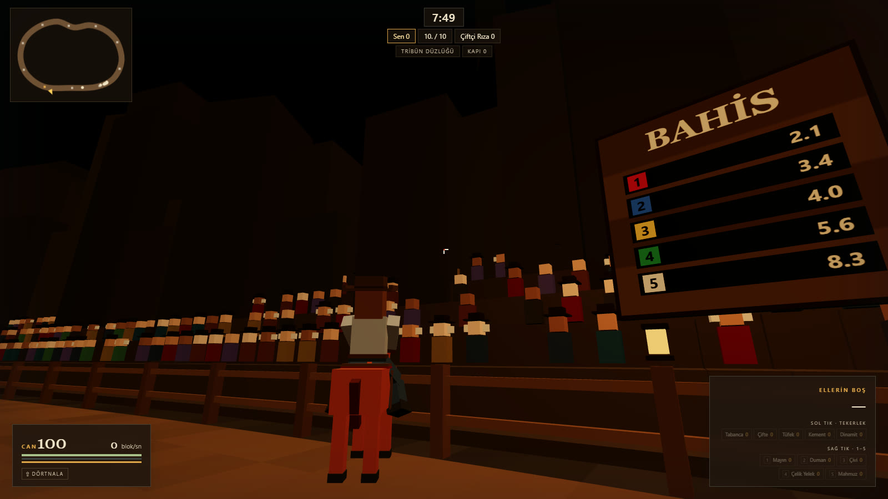
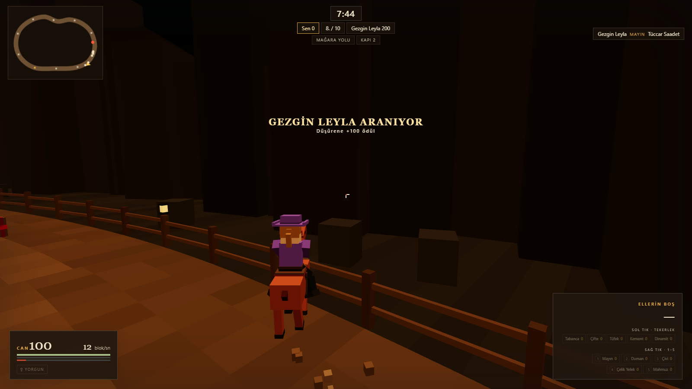

# Kara Nal

> **EN:** Mounted combat in a cave, in the browser (Three.js) with Juland's box characters: ten riders on an endless track, the most knockdowns wins; with bots or in an online room.
>
> **TR:** Tarayıcıda (Three.js) Juland'ın kutu karakterleriyle mağarada atlı çatışma: on binici bitmeyen pistte, en çok kişiyi düşüren kazanır; botlarla ya da çevrim içi odada.

**Play / Oyna:** https://karanal.josephuz.com · **Source / Kaynak:** https://github.com/JosephUz/karanal

<p align="center"></p>
<p align="center"> </p>

Juland'ın kutu karakterleriyle mağarada atlı çatışma. On binici bitmeyen bir döngü pistte koşar; amaç bitişe ilk
varmak değil, süre boyunca en çok kişiyi düşürmek. Geri dönüş yok: akışın tersine giden at şaha kalkar.
Yolda kırmızı sandıktan saldırı silahı (sol tık), mavi sandıktan savunma eşyası (sağ tık) toplanır; düşen eşyalarını
ganimet bırakır ve son geçtiği kapıdan eli boş çıkar. Oyun tasarımı: [PLAN.md](PLAN.md).

## Çalıştırma

```
npm install
npm start          # http://127.0.0.1:5220  (Baslat.cmd tarayıcıyı da açar)
npm test           # benzetim + sunucu testleri
```

`?otomatik=1` botlu koşuyu hemen başlatır, `?cevrimdisi=1` sunucuya bağlanmayı denemez, `?sunucu=ws://…` başka sunucu,
`?oda=KPRT-4` o odaya kendiliğinden katılır (davet linki). Sunucuda `KOSU_SURE=20 npm start` denemede koşuyu kısaltır.

## Düzen

| Dosya | Ne yapar |
| --- | --- |
| `src/ayar.js` | Bütün sayılar: at, geri gidilmez payı, maç, puan, 5 saldırı + 5 savunma, bot zorlukları ve huyları |
| `src/pist.js` | Döngü pist: denetim noktalarından eğri, 1 blokta bir örnek; (s, yanal) ↔ dünya, bölümler, kapılar, engeller, sandık yerleri |
| `src/at.js` | At sürüşü (istemci ve botlar aynı işlev): dönüş, tırıs/dörtnala/mahmuz, dayanım, çitler, engeller, geri gidilmez, topal, kement |
| `src/fizik.js` | Işın–dönük kutu, binici/at vuruş kutuları, engellerin atış kesen kutuları, tohumlu saçılma |
| `src/mac.js` | Maç: atış (geri sarmalı), hasar, düşme, ganimet, kapıda doğuş, sandıklar, mayın, çivi, duman, dinamit, puan, aranan |
| `src/bot.js` | Bot: avcı / kaçak / pusucu huyu, hedef seçimi (karşılık, aranan), silah seçimi, tuzak, sandığa sapma, engel atlama |
| `src/oda.js`, `src/ag.js` | Maçı istemcilere bağlar; botlu oyunda tarayıcıda, çevrim içi sunucuda aynı sınıf |
| `src/main.js` | İstemci: giriş, kendi atın, kamera, nişan, ara değerleme, göstergeler, mini harita, menüler, çevrim içi bölümü ve bekleme odası |
| `src/kod.js` | Oda kodu (KPRT-4) üretme ve düzeltme; sunucu ve istemci ortak |
| `src/sahne.js`, `src/karakter.js` | Three.js: mağara, çitler, kapılar, tribün, köprü, şelale, tünel, engeller, sandıklar, tuzaklar; binici + kutu at + silahlar |
| `src/avatar-veri.js` | Juland'dan kopya (6 hazır karakter). Juland'da değişirse buraya da kopyala |
| `server.mjs`, `server/odalar.mjs` | Statik dosyalar + WebSocket: açık oda listesi, hızlı katıl, oda kur, kodla katıl, bekleme odası (koltuk, kuran, ayarlar), jetonla geri dönüş ve 30 Hz koşular |

Ağ: herkes kendi atını yürütür ve konumunu yollar (30 Hz); oda ateşi istemcinin gördüğü ana (en çok 0,4 sn) geri sararak
hesaplar. Atı etkileyenler (çivi, kement, mahmuz) istemciye `etki` mesajıyla gider. Oda 10 koltuk; boş koltuklarda bot koşar.

## Çevrim içi akış

josephuz oda standardına uyar (`josephuz/docs/oda-standardi.md`; yazılar orada, birebir).

- Ana ekran: ADIN · BİNİCİN, BOTLAR ve **TEK BAŞINA ↗** · **ÇEVRİM İÇİ** (`● N çevrim içi`): **HIZLI KATIL →**, **ODA KUR**,
  **ODAYA KATIL** (ODA KODU + KATIL) · **AÇIK ODALAR** listesi (kuranın adı, `<Zorluk> botlar · n/10 binici`, LOBİDE/MAÇTA,
  KATIL →/DOLU). Liste sunucudan değişince gelir. Sunucu yoksa düğmeler kapalı, YAKINDA; liste gizli.
- Kod `KPRT-4` (4 harf + rakam); `kprt4` yazılırsa düzeltilir. Odadayken adres `?oda=KOD`; jeton sessionStorage'da
  (`karanal.oda`): sayfa yenilenince aynı koltuğa dönülür. Kopan oyuncunun koltuğu 60 sn tutulur, koşudaysa yerini bot oynar.
- Bekleme odası: kod, Linki kopyala, AÇIK ODA / ÖZEL ODA; 10 koltuk (sıra = çıkış dizilişi). Boş koltuğa tıklayan oraya
  geçer; kuran sürükleyip bırakır ya da oyuncuya sonra koltuğa tıklar (dolu koltukta yer değiştirir). Kuran bot zorluğunu ve
  odanın açık/özel olduğunu seçer, **MAÇI BAŞLAT ↗** der; kuran çıkınca kuranlık sıradaki insana geçer.
- Koşu sürerken gelen doğrudan koşuya girer, bir botun yerini alır. Koşu bitince oda bekleme odasına döner: sonuç ekranında
  **LOBİYE DÖN**. Tek başına koşu kendi döngüsünde (birkaç saniye sonra yeni koşu) kalır. Esc menüsünde çevrim içiyken
  **Odadan çık**, tek başınayken **Ana menü**.

## Yayın

- İstemci: Cloudflare Worker, `karanal.josephuz.com` → `npm run deploy:web`
- Sunucu: Docker + Cloudflare Tunnel, `karanal-sunucu.josephuz.com` → `docker compose --profile tunnel up -d --build`
  (`.env` içinde `TUNNEL_TOKEN`, paneldeki rota `http://localhost:5220`).

## Lisans / License

- **Kod:** [MIT](LICENSE), Copyright (c) 2026 JosephUz. Kodu kullanabilir, değiştirebilir, dağıtabilirsin.
- **MIT dışında, tüm hakları saklıdır:** "Kara Nal" ve "JosephUz" adları. Ayrıntı: [TRADEMARKS.md](TRADEMARKS.md).
- **Fork'lar** başka bir ad ve logo kullanmalı, resmî sürüm olduğunu ima etmemeli.
- **Üçüncü taraf:** [three.js](https://github.com/mrdoob/three.js) ve [ws](https://github.com/websockets/ws) npm bağımlılığıdır (ikisi de MIT), depoda değil, kendi lisanslarıyla gelir.

> **In English:** The code is licensed under [MIT](LICENSE). The name "Kara Nal", the name "JosephUz" are **not** covered by MIT and are all rights reserved; see [TRADEMARKS.md](TRADEMARKS.md). Forks must use a different name and logo.

## Katkı / Contributing

Hata bildirimi, öneri ve pull request'e açığız. Büyük bir değişiklikten önce bir [issue](https://github.com/JosephUz/karanal/issues) açıp konuşalım; oyunun dengesi ve yönü JosephUz'da. Kod ve oyun Türkçe: değişken, işlev ve mesaj adları Türkçe, çevresindeki kodun düzenine uy; `npm test` geçmeli. Gönderdiğin katkı bu deponun MIT lisansıyla yayımlanır. Müzik, ses ya da görsel eklemeden önce issue'da sor. Güvenlik açıklarını issue yerine [SECURITY.md](SECURITY.md)'deki yoldan bildir.

> **In English:** Issues and pull requests are welcome; please open an issue before large changes. Contributions are accepted under the MIT license of this repository. Report security issues privately as described in [SECURITY.md](SECURITY.md).
